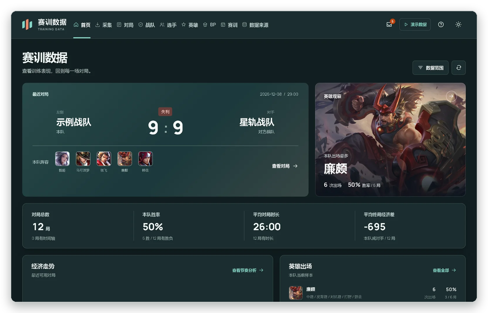
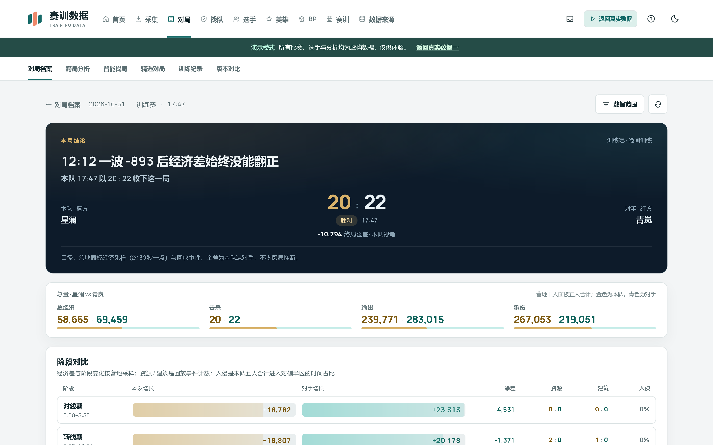
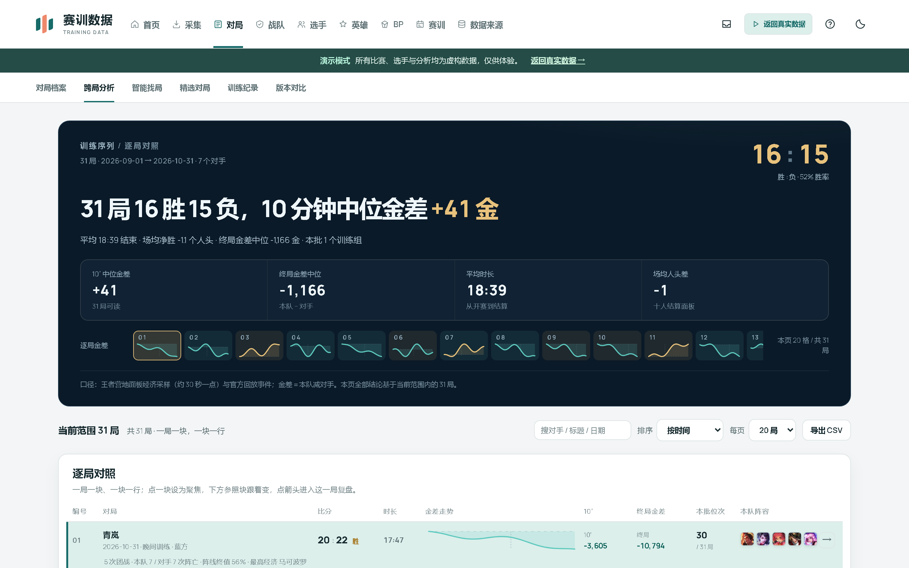
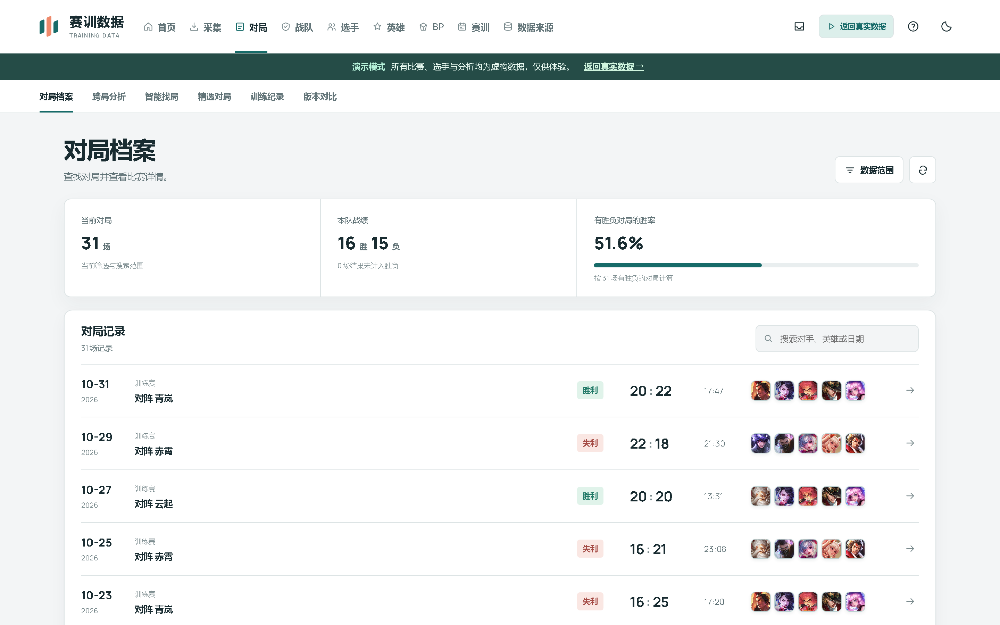
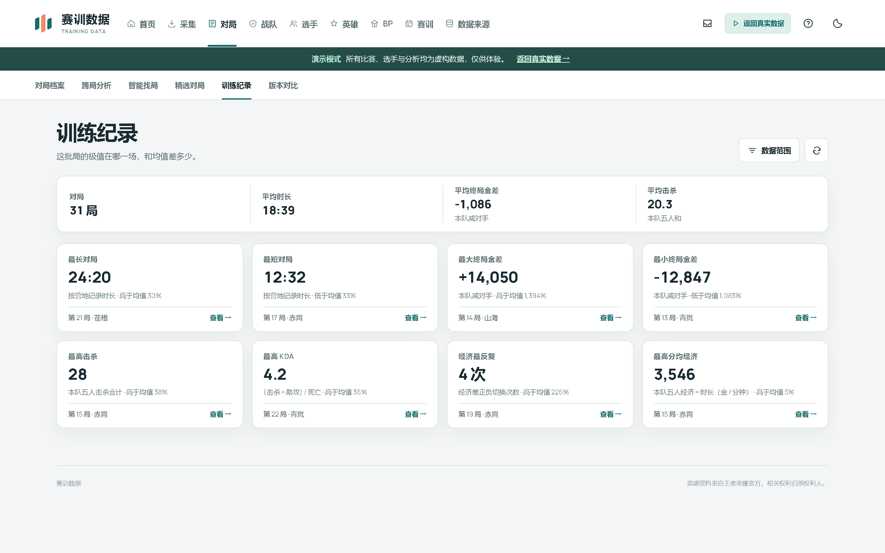
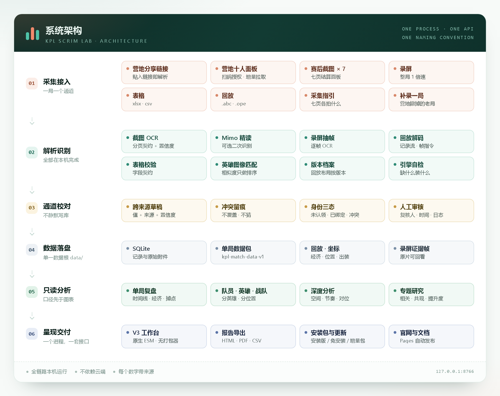
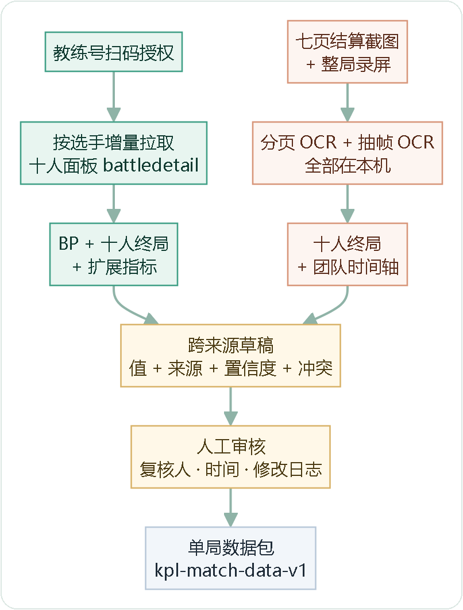
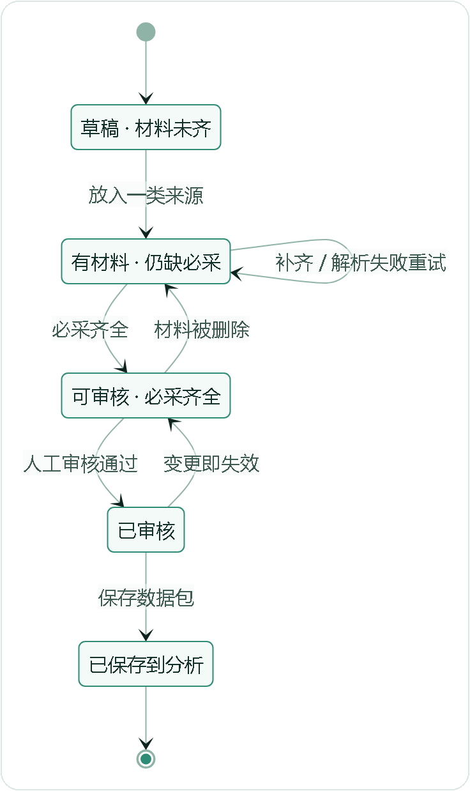
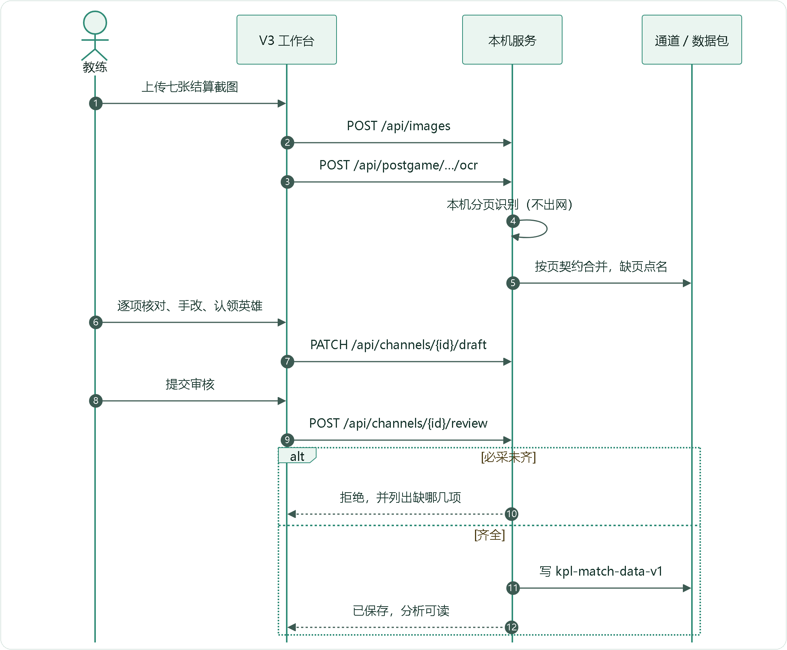

<div align="center">
  
  <h1>KPL 赛训数据平台</h1>
  <p><b>把一场训练赛的七张截图、一段录屏和一条营地链接，<br>变成一份能复盘的结论。</b></p>

  <p>
    
    
    
    
    
  </p>

  <p>
    <a href="https://hccccc01333.github.io/kpl-scrim-lab-site/"><b>官网</b></a>
    &nbsp;·&nbsp; <a href="https://gitee.com/Rainfun42/kpl-scrim-lab-app/releases"><b>下载安装包（国内）</b></a>
    &nbsp;·&nbsp; <a href="https://github.com/hccccc01333/kpl-scrim-lab-app/releases/latest">GitHub 备用</a>
    &nbsp;·&nbsp; <a href="#快速开始">快速开始</a>
    &nbsp;·&nbsp; <a href="#系统架构">系统架构</a>
    &nbsp;·&nbsp; <a href="#延伸阅读">延伸阅读</a>
    &nbsp;·&nbsp; <a href="CHANGELOG.md">更新日志</a>
  </p>
</div>

<p align="center">
  
</p>

<p align="center"><sub>V3 工作台 · 深色主题 · 界面内为合成演示数据</sub></p>

---

教练组从来不缺数据。缺的是把**赛后截图、录屏、表格、营地链接**变成结论的那一段路——
现在这段路靠人抄、靠 Excel、靠记忆。这个平台把它接起来：

> 采集 → 本机识别 → 逐项核对 → 来源留痕 → 只读分析 → 复盘结论

整套东西跑在**一台笔记本**上：一个 Python 进程、一个 SQLite 文件、一个 `data/` 目录。
没有账号体系，没有云端，没有需要登录的后台。

| 本机运行 | 每个数字带来源 | 不猜数据 |
| :-- | :-- | :-- |
| 识别、分析、存储都在这台电脑上完成。除了你主动触发的营地同步、OCR 组件安装和更新检查，它不访问任何第三方服务。 | OCR 候选、营地面板、回放事件各自标明出处与置信度；同一字段冲突就并列显示，不取平均、不互相覆盖。 | 缺字段就留空，部分数据不冒充全场终局；未绑定身份的记录不强行归到某个选手名下。 |

---

## v1.5.32 更新了什么

一句话：**单局复盘拆成四页、跨局分析按赛训组的问法分页、营地拿不到的数可以自己填。**

| 变化 | 具体做了什么 |
| :-- | :-- |
| **单局复盘** | 8000 像素的长页拆成「复盘 / 十人数据 / 事件 / 地图」四页签，地址带页签；BP 成为第一屏，新增「本局 BP 复盘」卡（对位命中 / 联动命中） |
| **分路指标** | 每个位置只看该看的：对抗路切C、打野反野经济、中单跑图、发育路打团存活、游走视野价值（营地派生卡片，首次被读出来） |
| **10 分钟经济** | 营地与回放都没有逐人金币时间轴，改成工作台手填 + 按分路出评级（6800 / 7000 / 7400）；不填就留空，不估 |
| **跨局分析** | 五个页签（这段时间 / BP 与阵容 / 五路与人 / 资源与团战 / 对手），删掉逐局对照台，「看这 N 局」在卡内展开并可导出 CSV |
| **阶段口径** | 全站锁死赛训组定义：0–4 对线、4–10 发育、10 分钟后；热区、脉搏、阶段对比、优势归因共用一处 |
| **事件与地图** | 比赛脉搏点位可点（龙 / BUFF / 塔 / 水晶分形分色）、塔名具体到「中路高地塔」、对位热区改离散分格、打野并线三段 × 三路 |
| **采集** | 一条营地链接自动补拉官方回放；营地载荷全量归档（字段表 + 前端文案），改版后可 diff |
| **BP 命中**（v1.5.30） | 对位压制改用**巅峰千强大盘**并做基准调整（减去英雄本身强弱，避免把「冷门英雄」误判成「被克制」）；新增**赛事命中**——本局阵容的组合在 KPL 出现过几次 |

完整说明见 [v1.5.29 版本说明](docs/release_1.5.29.md)、[v1.5.30 CHANGELOG](CHANGELOG.md)。

---

## 目录

[v1.5.29 更新了什么](#v1529-更新了什么) · [为什么需要它](#为什么需要它) · [界面](#界面) · [系统架构](#系统架构) · [采集与入库](#采集与入库) ·
[数据口径](#数据口径) · [功能地图](#功能地图) · [快速开始](#快速开始) · [配置](#配置) ·
[目录结构](#目录结构) · [开发与验证](#开发与验证) · [交付与更新](#交付与更新) ·
[延伸阅读](#延伸阅读) · [已知边界](#已知边界) · [参与贡献](#参与贡献) · [许可与免责](#许可与免责)

---

## 为什么需要它

一场训练赛结束，教练手上通常有：一张结算面板截图、一段录屏、一份手填表格、几个营地分享链接。
要让它们回答「这局前期是不是被压住了」「这个选手状态是不是在下滑」，中间隔着大量重复劳动。

| 现状 | 平台的做法 |
| :-- | :-- |
| 截图里的数字一个个抄进表格 | 本机 OCR 读出候选值，人工确认即入库；抄写环节被识别替换 |
| 抄错了没人发现 | 字段契约校验：缺失、类型不符、数值越界一律拦截 |
| 不同来源对不上 | 通道化：官方 / 营地 / 截图 / 表格各自留痕，冲突显式暴露 |
| 选手认错人 | 身份独立管理，未认领 / 已绑定 / 冲突三态，变更需人工确认 |
| 复盘靠记忆和 Excel | 时间线、经济曲线、掉点、阵容与对手档案自动生成 |
| 数字说不清哪来的 | 每个值带来源与置信度，四档口径写进界面 |

**平台不替你下结论。它把下结论需要的事实准备好，并且每个事实都能追到出处。**

---

## 界面

工作台共 26 条一级 / 二级路由，按「看数据」和「录数据」分开：分析页只读，写操作集中在采集、校对、身份与工作区。

<details>
<summary><b>展开：四张界面截图</b>（单局复盘 / 跨局分析 / 对局档案 / 训练纪录，均为演示数据）</summary>

<br>

| 单局复盘 | 跨局分析 |
| :-- | :-- |
|  |  |
| 先给一句结论，再给证据：阶段经济差、资源与建筑、逐局金差走势。口径写在卡片底部。 | 一局一块、一块一行；点开任意一局进入复盘，跨局比较只在当前筛选范围内成立。 |

| 对局档案 | 训练纪录 |
| :-- | :-- |
|  |  |
| 按日期、对手、版本、训练组筛；每行的比分、时长与阵容一眼可见。 | 极值卡：最长 / 最短对局、最大经济差、最高击杀与 KDA，并标出与均值的偏离幅度。 |

</details>

---

## 系统架构

<p align="center">
  
</p>

六层，一个进程。`server.py` 把采集、校对、分析、复盘、更新几组路由并进同一个 FastAPI 应用，
前端是 `/static` 下的原生 ES 模块——没有打包器，改完刷新即可。
2026-11-08 起 V1 / V2 入口退役，只剩这一套命名、一套接口。

| 层 · 选型 | 为什么是它 |
| :-- | :-- |
| **服务** · FastAPI + uvicorn，单进程 | 本机 HTTP 不需要分布式；路由按域拆成 APIRouter，仍是同一个 app |
| **存储** · SQLite + `data/` 目录 | 单文件数据库可整包备份；原始图片、录屏证据帧直接留档 |
| **识别** · RapidOCR（ONNX Runtime），可选 Mimo 精读 | 开箱即可识别且不联网；精读模型缺失时自动降级，而不是报错 |
| **前端** · 原生 ES module | 没有 node 工具链，教练机上改一行刷新就能看 |
| **测试** · pytest + Playwright | 后端用例 + 浏览器逐页渲染巡检；CI 在 3.11 / 3.12 上跑 |
| **交付** · 自带 Python 运行时的免安装包 | 目标机器不用装 Python，也不需要管理员权限 |

---

## 采集与入库

**一局一个通道**（`kpl-collection-channel-v1`）。同一局的截图、表格、录像报告、回放全部挂到这个通道上；
通道负责合并、暴露冲突、生成草稿，但**从不自己确认一局比赛**。

### 两条合规路径

<p align="center">
  
</p>

- **营地路径（窗口内主路径）**：教练号扫码授权后，按选手增量拉取十人面板 `battledetail`。BP、十人 KDA / 经济 / 输出 / 承伤 / 参团，以及补刀、野怪经济、治疗、控制等扩展指标直接进草稿，不经过 OCR。必须关联本局营地链接。
- **截图 / 录屏路径（OCR 新录入）**：王者营地只保留约一个月对局详情，更早的局没有通道可挂——在截图 OCR / 录屏 OCR 页直接从一组七页截图或一段录屏报告**新建一局并录入**。七页截图齐全，或一段十人阵容完整的录屏报告，任一即可建档、审核、保存；不要求营地链接。
- **补采**是另一件事：通道已经存在（通常是营地同步建的），只是缺截图 / 录屏素材，在同一个页面把素材补到已有对局即可。表格与回放文件始终选填。

两条路径汇合在同一份草稿上，审核通过后写入单局数据包 `kpl-match-data-v1`；分析页只读它，不再回头改通道。

### 门禁与审核

一个通道能不能保存，只看两件事：

- **必采齐没齐**：营地通道要求营地链接 + 双合规之一；OCR 新录入的通道要求七页截图或一段完整录屏之一。缺什么，缺失清单点明到「缺几位、缺哪页」。
- **审没审**：审核带复核人、时间与 `before/after` 日志；**任何来源变更都会让审核失效**，必须重审。

来源级状态是 `missing / parsed / partial / completed / failed`。这条规则没有例外——
宁可让人多审一次，也不让旧结论挂在新数据上。

<details>
<summary><b>展开：通道状态机与一次采集的时序</b></summary>

<br>

<p align="center">
  
</p>

<p align="center">
  
</p>

</details>

---

## 数据口径

这是平台最不肯让步的部分。**口径错了，图越好看越危险。**

| 标注 | 含义 | 典型来源 |
| :-- | :-- | :-- |
| **文件解码** | 从回放或表格文件里直接解出来的 | `.abc` 十人名单、实体 ID、表格数值 |
| **引擎实测** | 客户端运行时读到的引擎状态 | 检查点的金币 / KDA / 等级 |
| **UI 采样** | 从界面或小地图采样得到 | 营地逐秒位置、约 30 秒一次的经济点 |
| **估算** | 由已有数据推算，精度有限 | 插值坐标、未满场折算 |

六条硬规则：

1. **候选不写库**：OCR 只产出候选，确认后才成为记录。
2. **冲突不合并**：同一字段多来源不一致时并列保留并标记，不取平均、不静默覆盖。
3. **缺失不补零**：缺的字段留空，不按 0 参与统计。
4. **部分不冒充终局**：只有录屏快照的行标 `partial`，默认不进队员 / 英雄 / 团队统计；勾选后才展示，且 GPM / DPM 仍为空。
5. **变更有审计**：复核人、审核时间、`before/after` 修改日志都留在通道里。
6. **口径先于图表**：每个指标写明分母、样本量与计算条件；样本不足就说样本不足。

位置类数据额外标注采样与插值来源，不把「插值出来的坐标」说成「实测轨迹」。

---

## 功能地图

| 模块 | 入口 | 能做什么 |
| :-- | :-- | :-- |
| 首页 | `#overview` | 最近一局、胜负与时长、经济走势、英雄出场；右上角切换浅色 / 深色 |
| 采集 | `#ingest` | 营地连接与增量拉取、待审查列表、缺失值审查、老局新录入一局 |
| 截图 / 录屏 | `#capture` | 七页截图规范与逐页识别、录屏抽帧识别；补采到已有对局或直接新建一局 |
| 对局 | `#matches` | 对局档案、跨局分析、智能找局、精选对局、训练纪录、版本对比 |
| 战队 | `#teams` | 战队档案、战队风格、战队阵容、战队训练 |
| 选手 | `#players` | 选手档案、名单与状态、选手与位置、选手对比 |
| 英雄 | `#heroes` | 英雄榜、英雄对比、英雄组合 |
| BP | `#bp` | BP 概览、战队 BP、教练档案 |
| 赛训 | `#plan` | 训练计划、数据准备（身份对照 / 建档 / 对手归属 / 待确认）、复盘与报告 |
| 数据来源 | `#sources` | 营地、官方回放、表格、录屏各自的库存与覆盖情况 |

主路径只有一条：**首页 → 对局档案 → 单局 → 选手 / 英雄详情 → 对比**。

<details>
<summary><b>展开：分析能力与数据前提</b></summary>

<br>

| 分析 | 回答什么问题 | 前提 |
| :-- | :-- | :-- |
| 单局复盘 | 这一局发生了什么，转折点在哪 | 终局数据 + 可选营地回放 |
| 阶段经济 | 前期、中期、后期各自被拉开多少 | 营地经济采样（约 30 秒一点） |
| 掉点与团战 | 掉点发生在哪，之后经济怎么变 | 营地逐秒位置 / 回放事件 |
| 对位与热区 | 同位置对位差多少，活动范围在哪 | 逐秒位置 + 地图定标 |
| 选手状态 | 近期表现相对长期分布是升还是降 | 足够场次（算法有最低样本门槛） |
| 英雄池 | 池子多深、版本答案是什么 | 分英雄出场与胜负 |
| BP | 禁用名单、阵容构成、对手习惯 | 营地面板 BP（手序需人工补录） |
| 对手档案 | 和不同对手的历史比分与经济差 | 对手归属已确认 |
| 专题研究 | 领先能不能转化、哪些组合常一起赢 | 可复算的条件与样本，结果可导出 CSV |
| 训练效果 | 训练目标达成率、出勤、复盘完成率 | 训练计划与指标注册表 |

</details>

---

## 快速开始

需要 **Python 3.11 或 3.12**（CI 覆盖 3.11 / 3.12；3.13 暂不支持，因为 OCR 组件 1.4.x 只发布到 3.12）。

```bash
git clone https://github.com/hccccc01333/kpl-scrim-lab-app.git
cd kpl-scrim-lab-app

python -m venv .venv
.venv\Scripts\activate        # Windows
source .venv/bin/activate     # macOS / Linux

pip install -r requirements.txt
python server.py
```

打开 <http://127.0.0.1:8766/>。首次启动会自动创建 `data/` 与本地数据库。

Windows 也可以直接双击：

| 脚本 | 作用 |
| :-- | :-- |
| `安装依赖.bat` | 建虚拟环境并装依赖 |
| `启动工作台.bat` | 起服务并打开浏览器 |
| `启动工作台-守护.bat` / `启动工作台-后台.vbs` | 常驻运行，不占终端窗口 |
| `停止工作台.bat` | 优雅退出工作台 |

### 先看看它长什么样

```bash
python server.py                    # 一个终端
python scripts/seed_demo_data.py   # 另一个终端：灌入 12 场合成演示数据
```

演示数据的队名、选手、比分全部虚构，不含任何真实对局；不想要了就在首页点「返回真实数据」。

### 第一次用，按这个顺序走

1. **采集 → 营地连接**：教练号扫码授权，勾选本队选手，拉取最近的对局。
2. **采集 → 对局审查**：逐项核对缺失值与冲突，补 BP 手序，审核通过后保存。
3. **对局 → 对局档案**：点开刚保存的那局，先看结论卡，再看阶段经济与掉点。
4. **选手 / 英雄**：按位置或英雄看趋势，用「对比」把两名选手并排摆。

营地拿不到的老对局（超过一个月、选手隐藏战绩等），走「截图 OCR / 录屏 OCR → 新建一局并录入」，路径同上，只是识别改在本机做、不要求营地链接。已有对局缺素材时用「补采到已有对局」，两者不是一回事。

### 可选组件

| 能力 | 需要 | 没有会怎样 |
| :-- | :-- | :-- |
| Mimo 精读 OCR | `pip install -r requirements-mimo.txt` + 模型权重（约数 GB，不随仓库分发） | 自动跳过精读，只用主 OCR，准确率略低 |
| 录屏抽帧 | 「识别引擎」条里点**安装 ffmpeg**（自动下载解压到 `tools/ffmpeg`，不动系统 PATH），或直接用系统 PATH 里的 ffmpeg | 截图识别不受影响，录屏识别不可用 |
| 英雄 / 装备图标 | `python scripts/sync_catalog.py` | 跳过图像匹配，手工录入照常 |

V3 的「识别引擎」条会检测这三项，缺什么就在哪一行给出安装入口和原因，不用等到上传才报错。

---

## 配置

全部走环境变量，默认值适合本机开箱使用。

| 变量 | 默认 | 说明 |
| :-- | :-- | :-- |
| `TRAINING_HOST` | `127.0.0.1` | 监听地址；局域网 / 容器才改成 `0.0.0.0` |
| `TRAINING_PORT` | `8766` | 端口 |
| `TRAINING_DB` | `data/training.sqlite3` | 主数据库 |
| `KPL_DATA_DIR` | `./data` | 数据根目录；演示实例与测试用它隔离，不碰真实数据 |
| `ANALYSIS_MATCHES` | `data/matches` | 单局数据包目录 |
| `ANALYSIS_IMPORTS` | `data/imports` | 表格导入暂存 |
| `ANALYSIS_OFFICIAL` | `data/official_replays` | 营地回放缓存 |
| `KPL_RECORDINGS` | `data/recordings` | 录屏原片与 OCR 报告 |
| `TRAINING_ALLOWED_HOSTS` | `127.0.0.1,localhost,::1` | Host 白名单 |
| `TRAINING_ALLOW_REMOTE` | `0` | 是否允许非回环访问 |
| `MIMO_OCR_MODEL` | 空 | Mimo 权重路径 |
| `UPDATE_MANIFEST_URLS` | 空 | 自定义更新源，多个用逗号分隔 |

> 默认只监听回环地址。一旦放开局域网访问，平台**没有鉴权**——请只在受信任的网络里这么做。

---

## 目录结构

```
.
├── server.py                # 唯一入口：组装路由、中间件与静态资源
├── version.py               # 版本号单一来源（/api/health 与页脚都读它）
├── analysis_*.py            # 比赛记录仓库、聚合、经济 / 空间 / 画像分析
├── studio_*.py              # 分析工作台接口、可复算流水线、专题研究
├── depth_api.py             # 深度分析路由（对位、热区、经济时间轴）
├── channel_store.py         # 一局一个通道：草稿、来源状态、冲突、审核
├── collection_contract.py   # 采集契约：必采来源、七页截图、表格字段
├── ocr.py / postgame_*.py   # 截图 OCR 与分页合并
├── video_*.py / mimo_ocr.py # 录屏抽帧识别、Mimo 精读
├── camp_*.py                # 营地链接、授权、增量同步、BP 映射
├── replay_*.py              # .abc / .ope 回放解析、出装时间轴、检查点
├── identity_*.py            # 分边与认领的匹配规则
├── update_*.py / updater.py # 更新清单、下载、校验、替换与回滚
├── v3/public/               # V3 前端：原生 ES module + 单一样式表，无构建步骤
├── docs/                    # README 用的界面截图
├── scripts/                 # 部署自检、前端巡检、截图与种子数据
├── tests/                   # 后端用例
└── data/                    # 运行时数据（不进版本库）
```

`data/` 是唯一数据根，整包拷贝即可迁移：

```
data/
├── training.sqlite3       # 记录、原始附件、通道、回放索引
├── matches/               # 单局数据包 kpl-match-data-v1
├── official_replays/      # 营地回放：事件、经济、逐秒坐标
├── camp_details/          # 十人面板快照（补 BP 时可直接重放）
├── recordings/            # 录屏原片、OCR 报告、证据帧
├── replays/  builds/      # .abc / .ope 与出装时间轴
├── imports/  reports/     # 表格导入暂存、导出报告
└── backups/               # 备份与恢复产物
```

---

## 开发与验证

```bash
pip install -r requirements-dev.txt
python -m playwright install chromium

python -m pytest tests -q                    # 后端用例
python scripts/check_deploy.py               # 部署自检：缺什么依赖一眼看到
python scripts/verify_frontend.py --no-shots # 桌面 / 手机视口巡检
python scripts/verify_ui_pages.py            # 页面渲染与交互检查
```

CI 分两条流水线：**test** 在 3.11 / 3.12 上跑全量用例与部署自检；
**frontend** 做前端语法检查、路由渲染审计与真实浏览器巡检。
`test-results/` 存放截图、临时库和验收报告，已在忽略列表。

---

## 交付与更新

面向教练组的交付物是**安装包**或免安装包，不是仓库源码。公开仓库带的是平台运行时代码，打包与发版脚本留在源码发行版。

| 产物 | 用途 |
| :-- | :-- |
| `KPL赛训工具-<版本>-setup.exe` | 正式交付：双击安装，装到当前用户目录，卸载保留 `data/` |
| `KPL赛训工具-<版本>-full.zip` | 免安装版，内置 Python，解压即用；也是安装包的构建输入 |
| `patch-<版本>.zip` | 老用户增量更新，只含变更文件 |
| `update.json` | 更新清单：版本、说明、文件哈希 |

启动后在本机起一个服务，用浏览器打开工作台；关掉浏览器不影响数据，下次打开接着用。

更新在后台静默检查：下载增量包 → 校验哈希 → 替换程序文件 → 重启 → 健康检查，失败自动回滚。
`data/`、`.env`、`camp_auth.json` 永远不在更新范围内。

---

## 延伸阅读

公开仓库聚焦运行平台本身。更细的设计笔记——采集契约、回放协议、指标口径——留在源码发行版的 `docs/` 里。
能在这里直接读的有：

| 文档 | 讲什么 |
| :-- | :-- |
| [CONTRIBUTING.md](CONTRIBUTING.md) | 本地开发、测试与提交要求 |
| [CHANGELOG.md](CHANGELOG.md) | 逐版本改动：修了什么、加了什么 |
| [SECURITY.md](SECURITY.md) | 安全问题怎么报 |
| [v3/README.md](v3/README.md) | V3 前端入口、页面组织与当前边界 |
| [采集规范（离线页）](web/collection-guide.html) | 补采 vs 新录入、老局七页截图或录屏怎么拍 |
| [七页截图说明](web/capture-guide/README.md) | 每张截图提供哪些字段、哪些读不出来 |
| [素材来源](resources/SOURCES.md) | 英雄与装备素材的来源、许可与使用边界 |

---

## 已知边界

- **装备成型时间与装备收益分析尚未实现**——终局装备分布可查，「什么时候成型」还不行。
- **回放文件解析的界面入口按功能开关收起**，后端与工具链保留；营地回放的位置与事件不受影响。
- **营地详情只保留最近一个月**，更早的对局只能走七图 + 录屏补录，界面会直接标「营地无详情」。
- **单战队、单机**：多战队权限、账号体系与云端协作未实现；复核人是本机文本，不是登录账号。
- 界面上仍有个别旧版流程在往 V3 迁移；迁移只补基本信息，不猜阵容、对手与手序。

---

## 参与贡献

欢迎 Issue 与 PR，尤其是真实采集场景里踩到的坑。

- 先读 [CONTRIBUTING.md](CONTRIBUTING.md)；提交前跑一遍 `python -m pytest tests -q`。
- 新增指标先登记到 `metrics_registry.py`，不要在页面里手写口径。
- 采集契约的改动要同时更新 `collection_contract.py` 与相关说明。
- 涉及数据的改动请附样本量与来源；截图用演示数据，不要贴真实对局。

---

## 许可与免责

本项目自 **1.6.0** 起采用 **AGPL-3.0-or-later + 商业授权** 双轨（详见 [LICENSING.md](LICENSING.md)）：

- **免费使用**：个人、教学、研究、非营利组织，以及俱乐部/训练机构内部使用，都可以直接用、直接改。
- **开源义务**：如果修改后作为网络服务提供给他人，修改部分需要以 AGPL-3.0 公开。
- **商业授权**：要闭源集成、OEM 或不想开源，联系 [hccccc01333](https://github.com/hccccc01333)
  （`rainfun446 at gmail dot com`），或[提 Issue](https://github.com/hccccc01333/kpl-scrim-lab-app/issues) 说明场景。
- **历史版本**：1.5.x 及以前为 PolyForm Noncommercial 1.0.0，协议文本存档在
  [LICENSES/PolyForm-Noncommercial-1.0.0.txt](LICENSES/PolyForm-Noncommercial-1.0.0.txt)。

**素材与数据不在代码协议内**：英雄与装备图片归原权利人所有，仓库不分发，
由 `scripts/sync_catalog.py` 在本机按需获取；`data/` 下的对局与回放归使用者自己。
第三方依赖与字体许可见 [NOTICE](NOTICE)。

本项目是赛事训练分析工具，与游戏开发商及任何赛事组织方无关联，不对数据准确性作绝对保证。
请遵守游戏用户协议与所在地区的数据合规要求。
