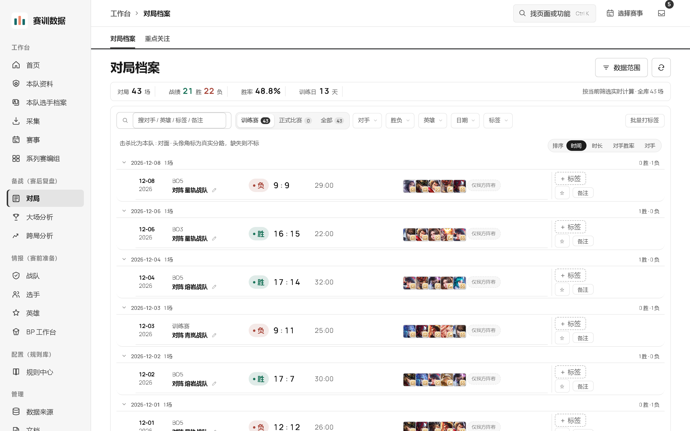
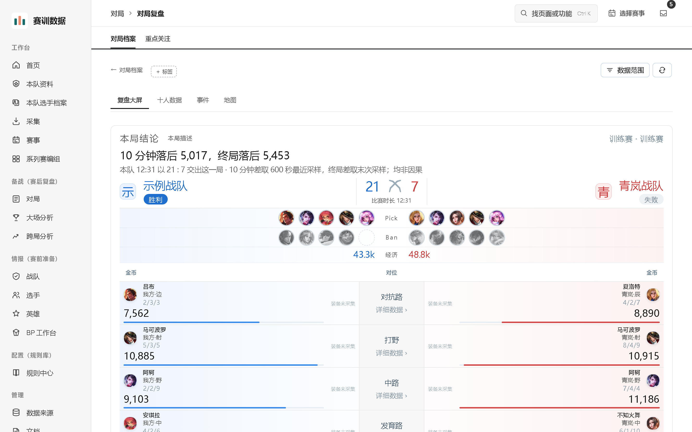
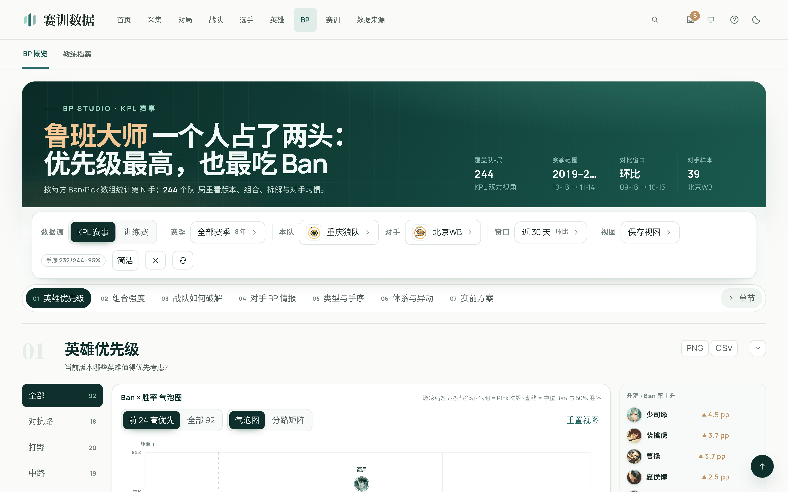
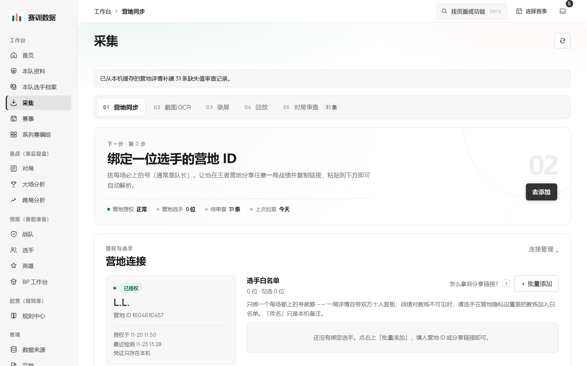

  
  <h1>KPL 赛训数据平台</h1>
  
<b>把一场训练赛的七张截图、一段录屏和一条营地链接， 变成一份能复盘的结论。</b>

  

    
    
    
    
    
  

  

    <a href="https://hccccc01333.github.io/kpl-scrim-lab-site/"><b>官网</b></a>
    &nbsp;·&nbsp; <a href="https://gitee.com/Rainfun42/kpl-scrim-lab-app/releases"><b>下载安装包（国内）</b></a>
    &nbsp;·&nbsp; <a href="https://github.com/hccccc01333/kpl-scrim-lab-app/releases/latest">GitHub 下载</a>
    &nbsp;·&nbsp; <a href="https://github.com/hccccc01333/kpl-scrim-lab-app"><b>⭐ 点个 Star 支持</b></a>
    &nbsp;·&nbsp; <a href="#快速开始">快速开始</a>
    &nbsp;·&nbsp; <a href="#界面一览">界面一览</a>
    &nbsp;·&nbsp; <a href="#更新日志">更新日志</a>
  

  

v3.0.1 工作台 · 白灰极简界面 · 界面内全部为合成演示数据

---

**面向 KPL、非 KPL 职业队、高校联赛、城市赛、青训与民间战队。** 不论打不打 KPL，采集 → 核对 → 入库 → 复盘都是同一条链路；KPL 数据只是可选的职业参照层，不影响任何一支队伍用完整功能。

教练组从来不缺数据，缺的是把**赛后截图、录屏、表格、营地链接**变成结论的那一段路——现在它靠人抄、靠 Excel、靠记忆。这个平台把这段路接起来：

> 采集 → 本机识别 → 逐项核对 → 来源留痕 → 只读分析 → 复盘结论

整套东西跑在**一台笔记本**上：一个 Python 进程、一个 SQLite 文件、一个 `data/` 目录。没有账号体系，没有云端，没有需要登录的后台。

---

## 为什么需要它

| 现状 | 平台的做法 |
| :-- | :-- |
| 截图里的数字一个个抄进表格 | 本机 OCR 读出候选值，人工确认即入库；抄写环节被识别替换 |
| 抄错了没人发现 | 字段契约校验：缺失、类型不符、数值越界一律拦截 |
| 不同来源对不上 | 通道化：官方 / 营地 / 截图 / 表格各自留痕，冲突显式暴露 |
| 选手认错人 | 身份独立管理，未认领 / 已绑定 / 冲突三态，变更需人工确认 |
| 复盘靠记忆和 Excel | 时间线、经济曲线、掉点、阵容与对手档案自动生成 |
| 数字说不清哪来的 | 每个值带来源与置信度，四档口径写进界面 |

**平台不替你下结论。它把下结论需要的事实准备好，并且每个事实都能追到出处。**

---

## 更新日志

### v3.0.1（2026-11-23）

- **BP 逐手前置**：应对分析的前置条件改为逐手一张卡片，补齐第 19 手（蓝方 5L），手号连续不跳号；后端支持逐手前置键。
- **按模式分手数**：KPL `draft-20` 显示 20 手（每方 5 Ban），训练赛 `draft-18` 显示 18 手（每方 4 Ban），切换模式后当前手号与提交条件同步切换。
- **文字可读性**：放大手序卡、中文标签、头像与手号，修复汉字被裁切和省略号截断。

### v3.0.0

视觉重建（白灰极简、语义色收敛）、复盘细节打磨、跨局与大场并轨；主前端固定为 `v3/public/`，交付版本号统一。

完整明细见 [CHANGELOG.md](CHANGELOG.md)。

---

## 快速开始

1. 到 [GitHub Releases](https://github.com/hccccc01333/kpl-scrim-lab-app/releases/latest) 或 [Gitee 下载页](https://gitee.com/Rainfun42/kpl-scrim-lab-app/releases) 取安装包：
   - `KPL-Scrim-Lab-3.0.1-setup.exe`：Windows 安装版，带自带 Python 运行时，不需要管理员权限。
   - `KPL-Scrim-Lab-3.0.1-full.zip`：免安装版，解压后双击「启动工作台.bat」。
2. 首次打开会弹出简短引导，照着走一遍即可；数据写在本机 `data/` 目录。
3. 想先看界面而不录入真实数据：任意页面可按提示载入合成演示数据，或打开 BP 工作台点「载入模拟数据」。

离线交付时，把 `patch-3.0.1.zip` 交给已安装用户，在工作台的更新面板里选「离线更新」即可。`setup.exe` 的 SHA-256 见 Release 里的同名 `.sha256` 文件。

---

## 界面一览

所有页面都是同一个应用上的路由，界面内为合成演示数据。

| 对局档案 | 单局复盘 |
| :-- | :-- |
|  |  |
| 按日期、对手、胜负、英雄与标签检索；一句结论先摆出来，证据随后。 | 比赛脉搏、阶段经济差、资源与建筑，口径写在卡片底部。 |

| BP 工作台 | 战队分析 |
| :-- | :-- |
|  |  |
| 英雄优先级、组合强度、对手 BP 情报、手序、赛前方案与应对分析，可切 KPL / 训练赛。 | 营地面板聚类识别对手，左边挑一支、右边看交手读数。 |

<b>展开：采集页截图</b>

 

---

## 它能做什么

侧栏按「先把自家底子建好，再做复盘与情报」排列，共 16 个一级入口：

| 分组 | 入口 | 能做什么 |
| :-- | :-- | :-- |
| 工作台 | 首页、本队资料、本队选手档案、采集、赛事、系列赛编组 | 赛训简报；沉淀本队底子；把素材录进来并编成系列赛 |
| 备战（赛后复盘） | 对局、大场分析、跨局分析 | 单局结论与证据；BO 系列横向比较；跨局趋势 |
| 情报（赛前准备） | 战队、选手、英雄、BP 工作台 | 对手索引与档案；选手状态；英雄池；BP 七段分析 |
| 配置与管理 | 规则中心、数据来源、文档 | 赛训词表与克制关系；各通道库存与覆盖；07 使用手册 |

主路径只有一条：**首页 → 对局档案 → 单局 → 选手 / 英雄详情 → 对比**。

---

## 采集与入库

**一局一个通道**。同一局的截图、表格、录像报告、回放全部挂到这个通道上；通道负责合并、暴露冲突、生成草稿，但**从不自己确认一局比赛**。

- **营地路径**：教练号扫码授权后，按选手增量拉取十人面板。BP、十人 KDA / 经济 / 输出 / 承伤 / 参团直接进草稿，不经过 OCR。
- **截图 / 录屏路径**：王者营地只保留约一个月对局详情，更早的局在截图 OCR / 录屏页直接从七页截图或一段录屏报告**新建一局并录入**，不要求营地链接。
- **补采**：通道已存在、只缺素材时，在同一页面把素材补到已有对局。表格与回放始终选填。

两条路径汇合在同一份草稿上。一个通道能不能保存只看两件事：**必采齐没齐**（缺什么点明到「缺几位、缺哪页」）、**审没审**（任何来源变更都会让审核失效，必须重审）。

---

## 数据口径

这是平台最不肯让步的部分。**口径错了，图越好看越危险。**

| 标注 | 含义 | 典型来源 |
| :-- | :-- | :-- |
| **文件解码** | 从回放或表格文件里直接解出来的 | `.abc` 十人名单、实体 ID、表格数值 |
| **引擎实测** | 客户端运行时读到的引擎状态 | 检查点的金币 / KDA / 等级 |
| **UI 采样** | 从界面或小地图采样得到 | 营地逐秒位置、约 30 秒一次的经济点 |
| **估算** | 由已有数据推算，精度有限 | 插值坐标、未满场折算 |

六条硬规则：

1. **候选不写库**：OCR 只产出候选，确认后才成为记录。
2. **冲突不合并**：同一字段多来源不一致时并列保留并标记，不取平均、不静默覆盖。
3. **缺失不补零**：缺的字段留空，不按 0 参与统计。
4. **部分不冒充终局**：只有录屏快照的行标 `partial`，默认不进队员 / 英雄 / 团队统计。
5. **变更有审计**：复核人、审核时间、`before/after` 修改日志留在通道里。
6. **口径先于图表**：每个指标写明分母、样本量与计算条件；样本不足就说样本不足。

---

## 系统架构

  

六层，一个进程。FastAPI 把采集、校对、分析、复盘、更新几组路由并进同一个应用；前端是 `v3/public/` 下的原生 ES 模块——没有打包器，改完刷新即可。

| 层 · 选型 | 为什么是它 |
| :-- | :-- |
| **服务** · FastAPI + uvicorn，单进程 | 本机 HTTP 不需要分布式；路由按域拆成 APIRouter，仍是同一个 app |
| **存储** · SQLite + `data/` 目录 | 单文件数据库可整包备份；原始图片、录屏证据帧直接留档 |
| **识别** · RapidOCR（ONNX Runtime） | 开箱即可识别且不联网；精读模型缺失时自动降级，而不是报错 |
| **前端** · 原生 ES module | 没有 node 工具链，教练机上改一行刷新就能看 |
| **测试** · pytest + Playwright | 后端用例 + 浏览器逐页渲染巡检 |
| **交付** · 自带 Python 运行时的安装包 / 免安装 zip | 目标机器不用装 Python，也不需要管理员权限 |

---

## 已知边界

- 这是本机工具，不做多人协同与云同步；备份就是复制 `data/` 目录。
- OCR 输出是候选值，必须人工确认；识别质量取决于截图清晰度。
- KPL 职业参照数据是可选层，缺失时不影响本队功能。
- 界面截图全部为合成演示数据，不代表任何真实队伍或比赛结果。

---

## 参与贡献

项目在 GitHub 上公开了安装包和更新清单。如果它帮到了你的赛训工作，**点个 ⭐ Star** 就是最直接的鼓励；也欢迎在 Issues 里反馈问题、贴错误码和复现步骤（**不要发送对局数据、选手姓名或账号**）。

反馈前可以先打开应用里的「文档 → 关于作者与项目来源」，那里有问题处理渠道和诊断信息说明。

---

## 许可与免责

AGPL-3.0。本项目与王者荣耀、KPL 及腾讯无隶属或授权关系；界面与文档中的战队、选手、对局均为演示数据。
